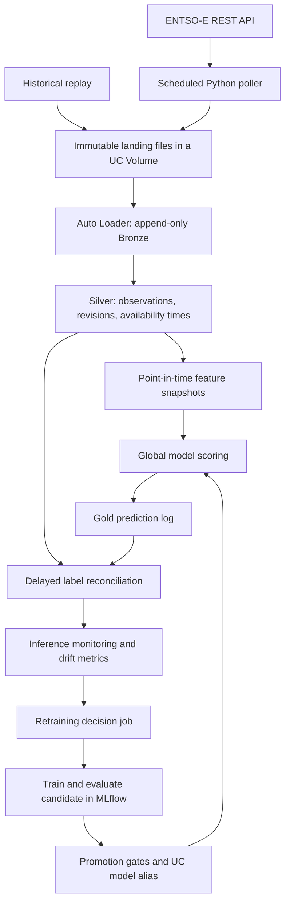

# eu-electricity-forecast implementation plan

Build an end-to-end Databricks demonstration of external data ingestion, streaming
feature computation, one global electricity price model, delayed-label evaluation,
drift detection, and controlled automatic retraining.

The repository is currently a renamed Databricks default-python starter. The
electricity ingestion, features, models, and monitoring below are planned work.

## Decisions to settle first

### Price product and forecast time

The original proposal combines day-ahead prices with a one-hour-ahead forecast.
Day-ahead prices are normally already published by that time. Forecasting an
already-published price would not demonstrate a useful forecasting task.
[ENTSO-E's price publication specification](https://transparencyplatform.zendesk.com/hc/en-us/articles/16647234190100-Energy-Prices-12-1-D)
also distinguishes mandatory day-ahead prices from voluntary intraday prices.

The agreed MVP is **day-ahead prices predicted before publication**, with a
historical replay mode to demonstrate the streaming and retraining lifecycle.
The forecast issue time must precede the auction results and be checked against
each input's publication schedule. Predict each delivery interval of the next
market day; the horizon varies with that interval. Daily forecast issuance and
streaming ingestion are separate schedules.

One-hour-ahead imbalance price forecasting is a possible later extension. It
would require separate checks of definitions, settlement-area mappings,
publication delays, revisions, and history. An imbalance settlement area need
not map one-to-one to a bidding zone. Keep price products separate.

### Initial scope

- Start coverage checks with DE_LU, FR, NL, and LT. Use the first two or three
  zones with adequate common coverage for the MVP, then extend the panel.
- Use one global LightGBM regressor with categorical zone identifiers.
- Predict absolute EUR/MWh first. Keep price-delta forecasting as a later experiment.
- Preserve source resolution. Start modeling on a common hourly grid if mixed
  historical resolutions require it; add native 15-minute modeling once coverage
  is verified. Never represent repeated hourly values as independent observations.
- Use scheduled incremental processing in development and configurable continuous
  micro-batches for a live demo. Set latency expectations from measured source
  publication delays, rather than describing the REST source as a live event feed.

The coupled day-ahead market moved to 15-minute MTUs for delivery from October 1,
2025. Historical resolution therefore needs explicit handling.
[ENTSO-E SDAC implementation history](https://www.entsoe.eu/network_codes/cacm/implementation/sdac/).

## Architecture

## Step 1 — Rename the starter and establish a development baseline

**Local rename completed:**

- Bundle and Python distribution: `eu-electricity-forecast`.
- Python package: `src/eu_electricity_forecast/`.
- Declarative pipeline: `src/eu_electricity_forecast_etl/`.
- Resource keys: `eu_electricity_forecast_job` and `eu_electricity_forecast_etl`.
- Update imports, notebook references, package entry point, and lockfile identity.

The checkout directory remains `/home/philippe/my_test_dab`; it can be moved from
its parent directory separately. It does not determine the deployed bundle name.

Next, install/configure the Databricks CLI and AI tools, explicitly select the
workspace profile, validate the bundle, and run a development smoke test.
The current agent environment has no Databricks CLI, so remote validation has
not been performed. Before deploying, inspect existing deployment state: changing
the bundle name and resource keys can create a separate deployment. Plan migration
of any existing resources rather than assuming this renames them in place.

**Done when:** the renamed wheel builds, imports and resource paths resolve, and
the development bundle validates and runs in the selected workspace.

## Step 2 — Verify source coverage and define the data contract

1. Obtain an ENTSO-E API token and store it in a Databricks secret scope. Configure
   the secret reference; never put the token or token-bearing request URLs in files.
2. Probe prices, total load, generation by type, load/renewable forecasts, and
   physical cross-border flows. Record usable zone/domain identifiers and validity
   periods in configuration; do not assume every endpoint uses the same domain.
3. Produce a coverage report by zone and data item: history, resolution, units,
   missingness, observed publication delay, and revisions. Target 12–24 months of
   history if available, including seasonal changes and the resolution transition.
4. Fix the price product, forecast issue schedule, target interval definition,
   feature cutoff, label maturity rule, and treatment of corrected prices.

Use UTC interval start/end times, with the zone's local timezone retained for
calendar features and DST-aware market days. Store MW separately from MWh and
validate price currency. Retain negative prices and investigate spikes rather
than dropping them as invalid.

Core observation fields:

`timestamp_utc`, `interval_end_utc`, `bidding_zone`, `data_item`, `value`, `unit`,
`resolution_minutes`, `source_document_id`, `revision`, `published_at_utc`
(if supplied), `first_seen_at_utc`, `ingested_at_utc`, and `run_id`.

Flow records also need origin, destination, and a documented sign convention.
Generation records need production type. Their keys extend beyond just zone and
timestamp; a wide Silver panel can later have one row per zone and interval.

**Done when:** a small authenticated pull confirms the contract and the forecast
target can be evaluated without using information published after issuance.

## Step 3 — Build historical ingestion and incremental polling

Implement a shared API client, parser, backfill command, and incremental poller.
Use small configurable query windows, request pacing, bounded retries with jitter,
and explicit handling of authorization failures, rate limits, and no-data responses.

ENTSO-E returns market documents, typically XML. Save the original response
without credentials and emit immutable JSON envelopes or normalized JSON lines for
Auto Loader. Preserve request metadata, document revision, response hash, parser
version, and a pointer to the original payload. Write only completed files to
the watched landing prefix.

Use a managed Unity Catalog Volume for the initial landing area; an external
volume can be configured when external storage ownership is needed. Keep
backfill, live, and replay runs distinguishable. Maintain a poll ledger and
re-query an overlap period to capture delayed publications and revisions.

Do not treat HTTP 200 alone as successful data ingestion: ENTSO-E can return a
no-matching-data acknowledgement. Its response guidance also documents UTC,
directional border queries, and daily response boundaries.
[ENTSO-E query responses](https://transparencyplatform.zendesk.com/hc/en-us/articles/15727773247124-Query-Response).

**Done when:** fixture-based parser tests cover multiple resolutions, missing
points, DST days, acknowledgements, and revisions; repeating a pull produces no
duplicate logical observations downstream.

## Step 4 — Replace taxi examples with Bronze and Silver pipelines

- Read landing JSON with Auto Loader into append-only Bronze streaming tables.
- Keep persistent schema/checkpoint state and rescued data; quarantine malformed
  rows with their source location and reason.
- Normalize into Silver price, load, generation, forecast, and flow tables.
- Preserve revision history and maintain a current view using document revision
  ordering and stable keys. A replay of an older revision must not overwrite a
  newer value.
- Use declarative change application or explicit idempotent merges. If a downstream
  stream reads mutable tables, use change data feed/change application rather than
  assuming updates appear in an ordinary append-only stream.
- Define quality expectations for identifiers, interval validity, units, freshness,
  duplicates, and coverage. Retain missingness indicators instead of inventing zero
  generation or zero flow.

Suggested tables: `bronze_entsoe_documents`, `silver_prices`, `silver_load`,
`silver_generation`, `silver_forecasts`, and `silver_cross_border_flows`.
Use configurable catalog/schema names and layer prefixes initially, fitting the
current bundle variables. Separate production permissions where needed later.

**Done when:** backfill and incremental runs converge, and restart/replay/revision
checks preserve the expected data and audit history.

## Step 5 — Implement point-in-time features

Build the same feature definitions for historical training and incremental scoring:

- Net load: demand minus solar and wind, with explicit actual/forecast variants.
- Observed price/load/generation lags and trailing aggregates over elapsed time.
- Generation changes at the native supported resolution; only compute a 15-minute
  delta when two appropriate observations exist.
- Hour/day/week cyclic encodings, local holidays, season, and zone category.
- Available neighbor-zone signals and signed interconnector flows.
- Data age, missingness, and source-resolution indicators.

For day-ahead issuance, use next-day load or renewable forecasts only when their
specific vintage was published before the cutoff. Actual next-day load,
generation, and flows cannot be features. Neighboring zones' future auction prices
must also be excluded. A categorical zone feature alone does not encode the
interconnector network; explicit neighbor features are needed for that claim.

Retain both delivery time and feature availability time. Preserve immutable
feature snapshots at issuance, keyed by zone, target interval, and issue time.
Register suitable Delta tables with Unity Catalog Feature Engineering and use
availability-aware point-in-time lookups.
[Databricks point-in-time feature joins](https://docs.databricks.com/aws/en/machine-learning/feature-store/time-series).

Start incremental lag computation by recomputing affected zones over a bounded
historical lookback and merging results. Include preceding batches' history;
computing lags inside just the incoming batch is incorrect. Handle corrections
through bounded recomputation and a separate repair path. Choose native streaming
state/window APIs only after checking the selected runtime's support.

Historical downloads may contain only final revisions. If original vintages or
availability cannot be reconstructed, label those backtests as approximate and
use conservative availability assumptions. Delta time travel does not recreate
source versions that were never ingested.

**Done when:** features pass cutoff/leakage checks and batch/incremental outputs
agree for the same history, including late data and batch boundaries.

## Step 6 — Train and register the first global model

1. Implement naive previous-day/previous-week same-local-slot baselines with
   explicit DST handling. Add persistence where appropriate for the chosen product.
2. Train one LightGBM model across zones. Store category mappings and preprocessing
   with the model and define behavior for previously unseen zones.
3. Use rolling chronological validation with a gap that prevents overlapping target
   windows across splits. Never randomly split panel rows across time.
4. Compare MAE/RMSE by zone, horizon, season, and price-spike regime, plus aggregate
   and equal-zone-weighted metrics. Avoid MAPE for prices near zero or negative.
5. Log code/configuration versions, feature contract, Delta versions, cutoff rules,
   training window, signature, category mappings, parameters, and metrics to MLflow.
6. Register the accepted version in Unity Catalog and assign a `Champion` alias.

**Done when:** a reproducible held-out evaluation establishes whether the global
model improves on the baselines, with visible limitations for individual zones.

## Step 7 — Score incrementally and reconcile delayed labels

Run inference at the schedule appropriate to the selected price product. Streaming
arrival of feature updates does not imply every update should issue a new forecast.

Write an immutable `gold_predictions` record containing zone, product, issue time,
target interval, horizon, prediction, model version, feature snapshot/version, and
run identifier. Resolve the champion version at a controlled batch boundary and
pin it for that batch. Make reruns idempotent by prediction identity.

When sufficiently mature prices arrive, join labels onto a separate evaluation
table without changing the original predictions. Preserve initial versus revised
labels and calculate label completeness and maturity. Missing labels are pending
evaluation, not zero-error predictions.

**Done when:** every scored row can be traced to a model and feature snapshot,
and retries, delayed labels, and label revisions behave correctly.

## Step 8 — Add monitoring and calibrated drift decisions

Configure Databricks data profiling (the capability previously called Lakehouse
Monitoring) for time-series/inference data, subject to workspace availability.
Refresh it on a defined schedule and evaluate only completed metric windows.

- Operational health: API failures, freshness, missingness, coverage, processing lag.
- Data drift: numeric-feature PSI versus an appropriate baseline, by zone and time
  window; retain a baseline snapshot associated with each champion.
- Model degradation: rolling MAE/RMSE on mature labels, by model and zone, compared
  with validation expectations and naive baselines.

Performance degradation is a signal to investigate possible concept drift; it
does not by itself prove that the conditional price relationship changed. Separate
source failures and label issues from retraining conditions. Account for normal
daily and seasonal changes when defining comparison windows.

Databricks exposes PSI and labeled regression metrics in its profiling outputs.
[Metric table documentation](https://docs.databricks.com/aws/en/data-governance/unity-catalog/data-quality-monitoring/data-profiling/monitor-output).

Calibrate thresholds through replay. As initial experiment settings only, test
PSI > 0.2 or MAE > 1.25 times its reference over multiple completed windows, with
adequate mature-label counts. Low-volume slices may require multi-day windows.
Drift alone should not force model promotion.

**Done when:** dashboards expose health, errors, and drift by zone/model, and the
decision logic stays quiet for routine variation while surfacing seeded problems.

## Step 9 — Implement closed-loop retraining and promotion

Use a Lakeflow Job to refresh the monitor, wait for completion, read fresh metrics,
persist a retraining decision, and conditionally run training/evaluation tasks.
SQL alerts can notify operators; the job makes the execution path explicit.
[Databricks profiling alerts](https://docs.databricks.com/aws/en/data-governance/unity-catalog/data-quality-monitoring/data-profiling/monitor-alerts).

Persist decision identity, reason, metric window, baseline version, model version,
and outcome in `gold_retraining_decisions`. Apply a cooldown, minimum fresh-data
requirement, job concurrency limit, and duplicate-event protection. Refuse training
when ingestion health or label completeness is inadequate.

Train a candidate on a configurable recent window with longer seasonal context
where coverage permits. Compare candidate and champion on the same untouched,
recent chronological holdout. Require an aggregate improvement and acceptable
per-zone regressions; exclude the holdout from candidate training and tuning.

Register the candidate regardless of promotion outcome. Move the `Champion` alias
only after gates pass. Keep the previous version for rollback, version the new
monitoring baseline, and record all promotion/rejection reasons. Failed training
or a worse candidate leaves the current champion active.

**Done when:** a qualifying event produces one audited retraining run, and both
successful promotion and candidate rejection have been demonstrated.

## Step 10 — Build a reproducible demo and production checks

Create a separate replay mode that releases historical data according to recorded
availability times at an accelerated pace. Use the same landing format and
downstream code. Where historical availability is inferred, show that limitation.
Keep replay tables, checkpoints, predictions, metrics, and models separate from
live resources.

Demonstrate a seasonal shift or a clearly labeled synthetic perturbation. Distinguish
a feature-distribution shock from a simulated change in the feature/target
relationship. Show ingestion, predictions, label arrival, drift decision,
retraining, evaluation, and promotion/rejection. Improvements must be measured;
they are not guaranteed by retraining.

Complete focused checks for parser correctness, revisions, DST, feature leakage,
restart idempotency, delayed labels, decision cooldowns, candidate rejection, and
rollback. Add lint/build/unit checks and bundle validation in CI; run workspace
integration checks separately from offline tests. The current starter tests
initialize Databricks Connect, so refactor them before using them as offline tests.

Replace the production target's personal ownership with a configured service
principal/run identity and explicit grants before production deployment. Confirm
runtime/dependency compatibility, API egress, monitor availability, failure
notifications, retention/checkpoint policy, replay recovery, and compute budgets.
Keep development schedules paused by default.

**Done when:** the demo is repeatable from a clean development deployment, every
model change is auditable, and failures recover without silently losing data.

## Proposed implementation slices

| Slice | Scope | Reviewable outcome |
| --- | --- | --- |
| 1 | Rename and planning | This change; day-ahead target agreed; workspace prerequisites remain |
| 2 | Source contract, parser, backfill, Bronze/Silver | Real, validated ENTSO-E panel data |
| 3 | Historical features, baselines, global model | Leakage-aware MLflow evaluation |
| 4 | Incremental features, scoring, delayed labels | Traceable forecasts from streaming ingestion |
| 5 | Monitoring, retraining gates, replay | Demonstrable closed loop with promotion and rejection |
| 6 | CI, operational checks, production identity | Repeatable deployment and recovery runbook |
